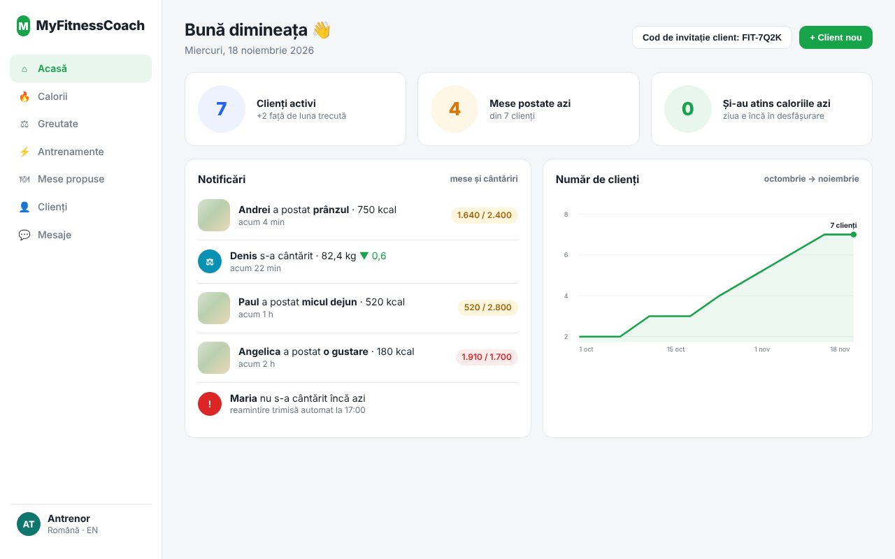
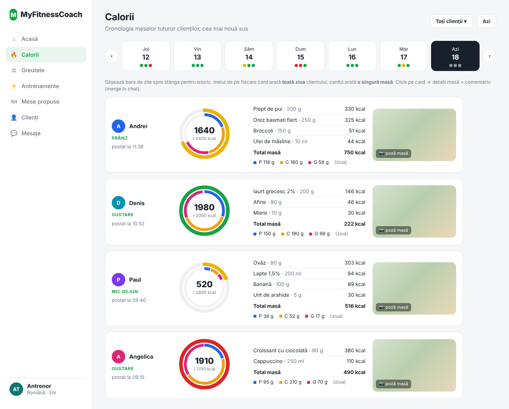
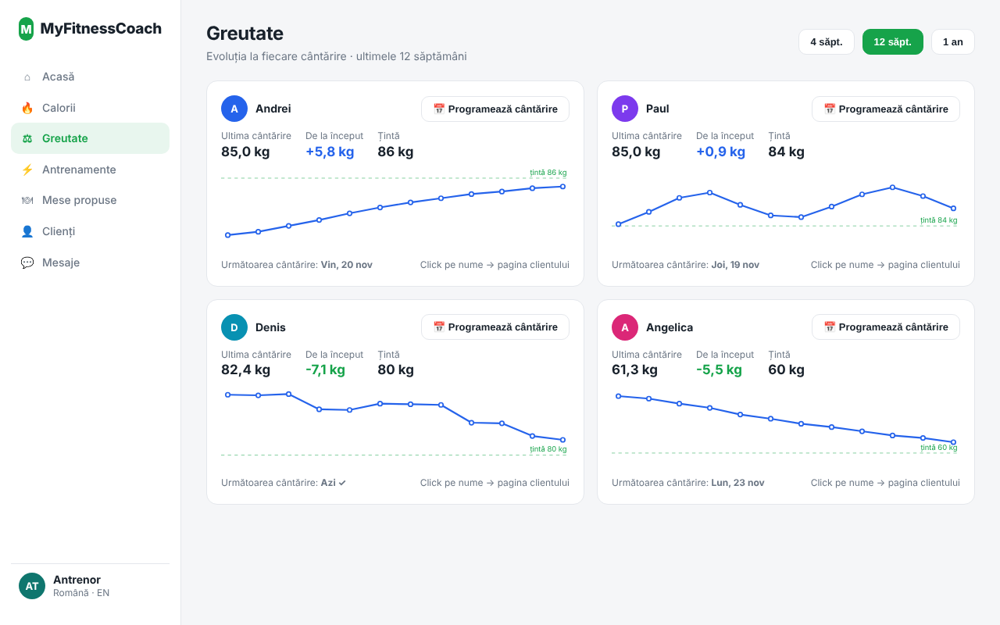
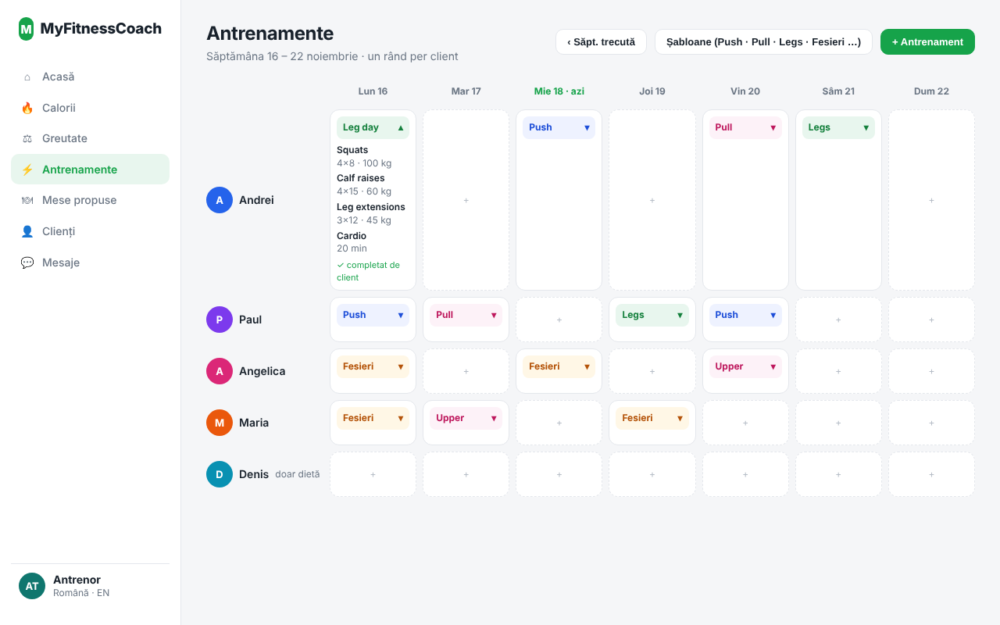
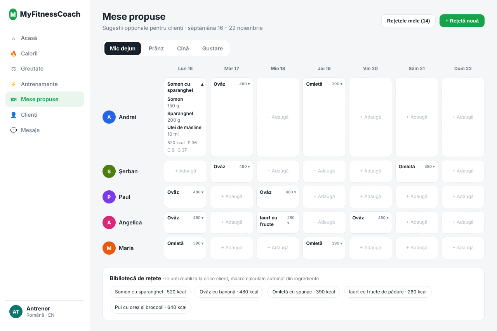
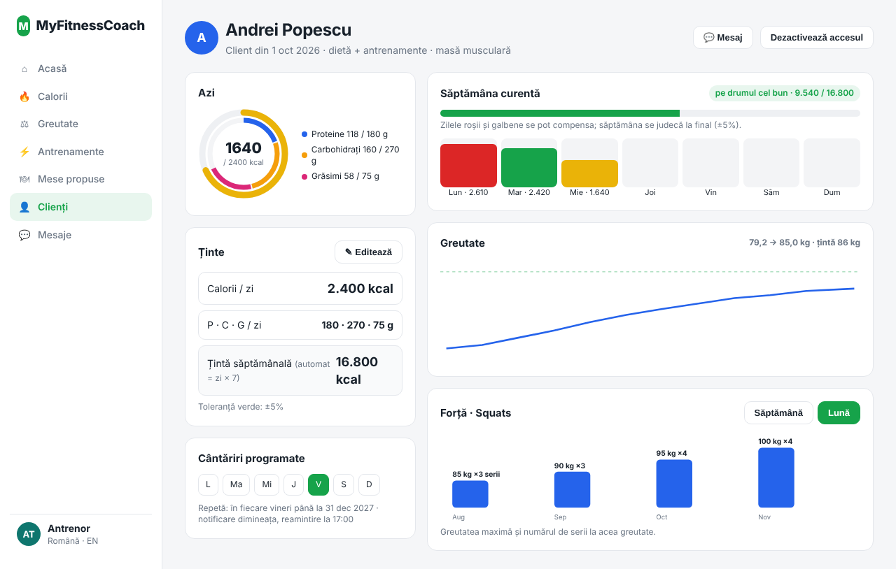
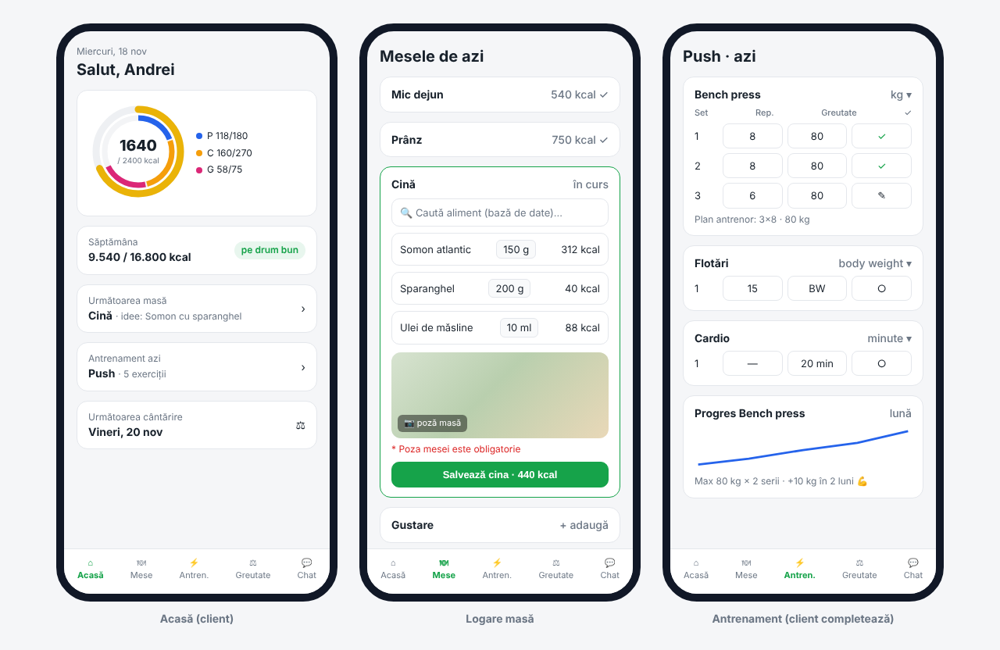

# MyFitnessCoach — Specificație funcțională (v1)

> Document de input pentru Claude Code. Descrie **ce** face aplicația, nu **cum** se implementează.
> Specificațiile tehnice (stack, bază de date, hosting) se vor discuta separat, după aprobarea acestui document.
> Mockup-urile vizuale se găsesc în folderul [`mockups/`](mockups/) (HTML deschis în browser + capturi PNG în `mockups/png/`). Sunt orientative: păstrează structura și ideea, nu sunt bătute în cuie.

---

## 1. Viziune

MyFitnessCoach este o aplicație de tip MyFitnessPal, dar **construită pentru antrenori personali**. Antrenorul își supervizează toți clienții dintr-un singur dashboard: vede „live” ce mănâncă, cum evoluează greutatea și cum merg antrenamentele de la sală. Clientul folosește aplicația ca să își logheze datele și să își vadă progresul (factor motivator).

- Este un **instrument intern** între antrenor și clienții lui. Nu există profil public, feed social sau descoperire de antrenori.
- Antrenorul se întâlnește fizic cu clientul la sală; aplicația este instrumentul de **contorizare detaliată** dintre întâlniri.
- Prima versiune este intenționat simplă: fără funcții complicate, fără butoane inutile.
- Numele aplicației: **MyFitnessCoach**.

## 2. Roluri și acces

| Rol | Ce vede | Platformă |
|---|---|---|
| **Antrenor** | Toți clienții săi, toate datele lor | Web (laptop / desktop) |
| **Client** | Doar propriile date și programul primit de la antrenorul lui | Telefon (mobil) și web |

Reguli:
1. **Un client are exact un antrenor.** Un antrenor poate avea oricâți clienți (dashboardul nu se schimbă, antrenorul doar face scroll).
2. **Legătura client–antrenor** se face printr-un **cod de invitație** generat de antrenor. Clientul își creează contul, introduce codul și devine clientul acelui antrenor.
3. Un client nu vede niciodată datele altor clienți ai antrenorului.
4. **Acces condiționat de relația cu antrenorul:** clientul păstrează accesul doar cât timp este activ la antrenor (cât îl plătește). Când antrenorul îl dezactivează, clientul **pierde accesul la aplicație** și **nu mai are acces la informațiile primite de la antrenor** (planuri, rețete, programări).
5. Plata (cine plătește aplicația și cât) **nu este decisă** – vezi secțiunea 12. În v1 nu există plăți în aplicație.
6. Un client poate avea doar dietă (fără antrenamente): antrenorul pur și simplu nu îi programează antrenamente. Antrenamentele sunt opționale.

## 3. Dashboard-ul antrenorului

Navigare laterală (sidebar), comună tuturor paginilor: **Acasă · Calorii · Greutate · Antrenamente · Mese propuse · Clienți · Mesaje**. Paginile din schițe sunt un demo minim; aplicația poate avea mai multe pagini.

### 3.1 Acasă

- **Trei indicatori** în partea de sus:
  1. numărul de clienți activi;
  2. numărul de mese postate azi;
  3. numărul de clienți care și-au atins caloriile pe ziua de azi (inel verde).
- **Flux de notificări**: mese postate (ex. „Andrei a postat prânzul · 750 kcal”) și cântăriri (ex. „Denis s-a cântărit · 82,4 kg ▼0,6”), plus cântăriri ratate. **Fără notificări de antrenamente.** Click pe o notificare duce la detaliul respectiv.
- **Grafic** cu evoluția numărului de clienți pe ultima lună.
- Buton pentru **codul de invitație** și pentru adăugare client nou.

Minimalist: Acasă arată doar sumarul; fiecare zonă are pagina ei dedicată.

### 3.2 Calorii (cronologia meselor)

- Un **flux cronologic** al meselor postate de toți clienții, **cea mai nouă masă sus** (ca un timeline).
- **Un card = o singură masă** a unui client. Cardul conține:
  - numele clientului (+ avatar), tipul mesei (mic dejun / prânz / cină / gustare / masă suplimentară), ora postării;
  - **inelul de progres pentru TOATĂ ZIUA clientului** (nu doar pentru masa respectivă) – vezi secțiunea 5;
  - legenda macro (proteine / carbohidrați / grăsimi) pentru ziua respectivă;
  - lista de ingrediente cu gramaj și calorii, plus totalul mesei;
  - **poza mesei**.
- **Bară mare de zile în partea de sus** (slider) pentru navigarea în istoric: glisezi spre stânga ca să vezi zilele anterioare. Fiecare zi poate afișa mici puncte colorate cu starea clienților în acea zi.
- Când te uiți la o zi trecută, fluxul e tot cronologic, deci primele carduri sunt ultimele mese ale zilei (de obicei cina), iar în cazul ideal toate inelele sunt verzi.
- **Click pe un card** → detaliile mesei (poză mare, ingrediente, macro) și posibilitatea de a **comenta** (comentariul merge în chat, vezi secțiunea 6).
- Filtru opțional pe client.

### 3.3 Greutate

- Câte un card per client, cu:
  - **ultima cântărire** (kg), diferența de la început, ținta (dacă există);
  - **grafic** care urcă/coboară de la o cântărire la alta;
  - buton **„Programează cântărire”**;
  - data următoarei cântăriri programate.
- Selector de interval (ex. 4 săptămâni / 12 săptămâni / 1 an).
- Se urmărește **doar greutatea** (fără % grăsime, circumferințe sau poze de progres în v1).

### 3.4 Antrenamente

- **Calendar săptămânal**: zilele pe coloane, clienții pe rânduri.
- Antrenorul pune în fiecare zi un **antrenament cu titlu liber** (Push / Pull / Legs / Fesieri / Upper / orice nume vrea).
- Fiecare antrenament se poate **expanda** (săgeată) și arată exercițiile: nume exercițiu, serii, repetări, greutate (sau minute / body weight).
- Antrenorul poate fixa **seriile, repetările și greutatea** propuse; clientul le poate modifica la completare (poate nu a reușit).
- Indicator că un antrenament a fost **completat de client**.
- **Șabloane de antrenament** reutilizabile (ex. „Leg day” salvat o dată și aplicat oricărui client / oricărei zile).
- Navigare între săptămâni. Fără drag & drop în v1.
- Clienții „doar dietă” au rândul gol.

### 3.5 Mese propuse (rețete)

- Calendar săptămânal identic ca structură cu cel de antrenamente (zile pe coloane, clienți pe rânduri), cu un **selector de masă** sus: Mic dejun / Prânz / Cină / Gustare.
- În fiecare celulă: rețeta propusă (ex. „Somon cu sparanghel”), expandabilă în **ingrediente cu gramaj** (150 g somon, 200 g sparanghel, 10 ml ulei de măsline) și macro **calculate automat** din baza de alimente.
- Scopul: îl ajută pe client să își atingă macro fără să le depășească, și să știe ce să cumpere / ce să mănânce.
- **Propunerile NU sunt obligatorii.** Clientul poate mânca altceva; de aceea mesele propuse și mesele logate sunt pe pagini diferite.
- **Bibliotecă de rețete** a antrenorului: rețetele se salvează și se reutilizează la orice client.

### 3.6 Pagina unui client

Se deschide la **click pe numele unui client** (din orice pagină). Conține toate funcțiile, „la scară mare”, doar pentru acel client:
- **inelul zilei** curente cu macro detaliate (consumat / țintă);
- **ținte**: calorii pe zi (**editabile** de antrenor) și macro pe zi (P/C/G);
- **ținta săptămânală**, calculată **automat** din ținta zilnică (zi × 7), cu progresul săptămânii curente și zilele colorate;
- **grafic mare de greutate**;
- **programarea cântăririlor** (vezi 4.4);
- **grafice de forță** per exercițiu (greutate maximă și număr de serii la acea greutate, pe săptămână/lună);
- calendarul lui de antrenamente și de mese propuse;
- buton de **mesaj** (chat) și buton de **dezactivare a accesului** clientului.

### 3.7 Mesaje
Chat 1-la-1 între antrenor și fiecare client (vezi secțiunea 6).

## 4. Aplicația clientului

Aceleași funcții ca antrenorul, dar **doar pentru el**. Pe mobil: bară de navigare jos (Acasă · Mese · Antrenamente · Greutate · Chat).

### 4.1 Acasă (client)
- Inelul zilei (calorii în centru, macro colorate);
- **ținta săptămânală** și progresul ei (vizibilă, dar cea mai importantă rămâne ținta zilnică);
- următoarea masă (cu sugestia antrenorului, dacă există);
- antrenamentul de azi;
- următoarea cântărire.

### 4.2 Logare mese
- **4 categorii fixe**: mic dejun, prânz, cină, gustare + buton **„+”** pentru mese suplimentare. Contează totalul macro al zilei, nu numărul de mese.
- Pentru fiecare masă clientul introduce **ingredientele** și **gramajul**:
  - caută ingredientul în **baza de alimente** (secțiunea 7);
  - macro și calorii se **calculează automat** în funcție de gramaj;
  - gramajul poate fi **editat**.
- **Poza mesei completă este OBLIGATORIE la fiecare masă** (masa nu se poate salva fără poză) – ca să fie mai greu de mințit antrenorul.
- Clientul poate **folosi o rețetă propusă** de antrenor ca punct de plecare (ingredientele se precompletează, gramajul se poate ajusta).
- Clientul poate vedea pe o pagină separată **mesele propuse** de antrenor.

### 4.3 Antrenamente (client)
- Exercițiile sunt deja puse de antrenor. Clientul completează pentru fiecare set: **repetări** și **greutate** (și poate adăuga/șterge seturi).
- Valorile propuse de antrenor apar precompletate; clientul le **poate edita**.
- **Unitate de măsură per exercițiu**: **kg**, **minute** sau **body weight**.
- **Grafic de forță** per exercițiu: **greutatea maximă** și **numărul de serii la acea greutate**, cu vizualizare pe săptămână / lună (factor motivator).

### 4.4 Greutate (client) și cântăriri programate
- Antrenorul programează **una sau mai multe zile din săptămână** pentru cântărire. Programarea poate fi făcută **pe termen lung** (ex. tot anul, cu repetare săptămânală), ca antrenorul să nu fie nevoit să o refacă des.
- Cântărirea programată este **valabilă toată ziua**.
- Clientul primește o **notificare dimineața** în ziua cântăririi și o **reamintire la ora 17:00** dacă nu s-a cântărit încă.
- Clientul vede un **grafic cu evoluția greutății** față de ținta lui.

## 5. Logica de calorii și macro (inelul zilnic)

### 5.1 Ținte
- **Ținta zilnică de calorii este stabilită de antrenor** (și macro: proteine, carbohidrați, grăsimi). Este aceeași în fiecare zi.
- **Ținta săptămânală** = ținta zilnică × 7, calculată automat (nu se editează separat).

### 5.2 Inelul
- **Caloriile consumate** sunt afișate **în mijlocul cercului** (ex. „1640 / 2400 kcal”).
- Inelul se umple pe parcursul zilei; **macro (P/C/G) apar ca segmente colorate** în cerc și ca legendă lângă cerc (procent sau grame).
- În mockup-uri: inelul exterior = progresul caloriilor (culoarea stării), inelul interior = împărțirea pe macro.

### 5.3 Culori (stări)
| Stare | Condiție | Culoare |
|---|---|---|
| Sub țintă | < 95% din ținta zilnică | **Galben** (galben-portocaliu) |
| La țintă | între 95% și 105% (±5%) | **Verde** |
| Depășit | > 105% | **Roșu** |

### 5.4 Echilibrare săptămânală
- Zilele se pot compensa între ele: în zilele de antrenament clientul poate mânca mai mult (roșu), în zilele de repaus mai puțin (galben).
- **Săptămâna se judecă la final**: dacă totalul săptămânal este în ±5% din ținta săptămânală, săptămâna este **verde**, chiar dacă au existat zile roșii și galbene.
- Exemplu valid: 4 zile roșii + 3 zile galbene → săptămână verde.

## 6. Comunicare (chat)

- Chat **1-la-1** între antrenor și fiecare client.
- Antrenorul poate **comenta o masă** a clientului: comentariul apare **în chatul dintre ei, alături de poza mesei** (ca un răspuns la un story pe Instagram). Astfel dashboardul nu se aglomerează.
- Antrenorul poate trimite **mesaje text libere**. Fără butoane speciale de „alertă” – dacă vrea să atenționeze clientul, îi scrie.
- Mesajele se **traduc automat** între română și engleză (vezi secțiunea 9).

## 7. Baza de alimente

- Bază de date **mare** cu alimente și valorile lor nutriționale (calorii, proteine, carbohidrați, grăsimi per 100 g / 100 ml).
- Căutare rapidă după nume; calcul automat în funcție de gramaj.
- **Atât antrenorul, cât și clientul pot adăuga alimente lipsă.**
- Rețetele antrenorului sunt compuse din alimente din această bază; macro rețetei se calculează automat.
- **Fără scanare de cod de bare în v1.**

## 8. Notificări

| Destinatar | Eveniment |
|---|---|
| Antrenor | Client a postat o masă (cu calorii) |
| Antrenor | Client s-a cântărit |
| Antrenor | Client a ratat o cântărire programată |
| Client | Dimineața în ziua de cântărire programată |
| Client | Reamintire la 17:00 dacă nu s-a cântărit |
| Client | Mesaj / comentariu nou de la antrenor |

Notificările de antrenamente **nu** apar în fluxul antrenorului.

## 9. Limbi

- **Română și engleză**, interfața în ambele limbi.
- Conținutul introdus de utilizatori (mesaje, comentarii, nume de rețete) se **traduce automat** pentru cealaltă parte, dacă limbile diferă.

## 10. Platforme

- **Antrenor:** aplicație web, gândită pentru laptop/desktop.
- **Client:** telefon (mobil) și web.

## 11. Ce NU intră în prima versiune

- Scanare cod de bare
- Plăți în aplicație
- Antrenamente cardio cu GPS / integrare cu ceasuri sau aplicații externe
- Profil public / descoperire de antrenori / feed social
- Drag & drop în calendar
- Butoane de alerte predefinite (se folosește chatul)
- Măsurători corporale în afară de greutate (% grăsime, circumferințe, poze de progres)

## 12. Întrebări deschise

1. **Modelul de plată:** cine plătește aplicația (antrenorul, clientul sau ambii) și cât. Cum se leagă „clientul nu mai plătește” de dezactivarea accesului (manual de antrenor sau automat).
2. **Export de date:** dacă și ce poate exporta antrenorul (ex. PDF/CSV cu progresul unui client).
3. **Sursa bazei de alimente:** bază publică existentă, bază proprie sau combinație; cum se verifică alimentele adăugate de utilizatori.
4. **Ținte de greutate:** le setează antrenorul per client (mockup-urile presupun că da).
5. **Retenția datelor** după dezactivarea unui client: se păstrează (pentru reactivare) sau se șterg după o perioadă.

## 13. Index mockup-uri

| Fișier | Ecran |
|---|---|
| [`mockups/01-acasa.html`](mockups/01-acasa.html) | Antrenor · Acasă |
| [`mockups/02-calorii.html`](mockups/02-calorii.html) | Antrenor · Calorii (cronologie mese) |
| [`mockups/03-greutate.html`](mockups/03-greutate.html) | Antrenor · Greutate |
| [`mockups/04-antrenamente.html`](mockups/04-antrenamente.html) | Antrenor · Antrenamente (calendar) |
| [`mockups/05-mese-propuse.html`](mockups/05-mese-propuse.html) | Antrenor · Mese propuse (rețete) |
| [`mockups/06-client-detaliu.html`](mockups/06-client-detaliu.html) | Antrenor · Pagina unui client |
| [`mockups/07-client-mobil.html`](mockups/07-client-mobil.html) | Client (mobil) · Acasă, Logare masă, Antrenament |

Fișierele HTML folosesc `mockups/style.css` și `mockups/common.js` (doar pentru desenarea inelului și a meniului; **nu** este cod de aplicație). Capturile PNG sunt în `mockups/png/`.
