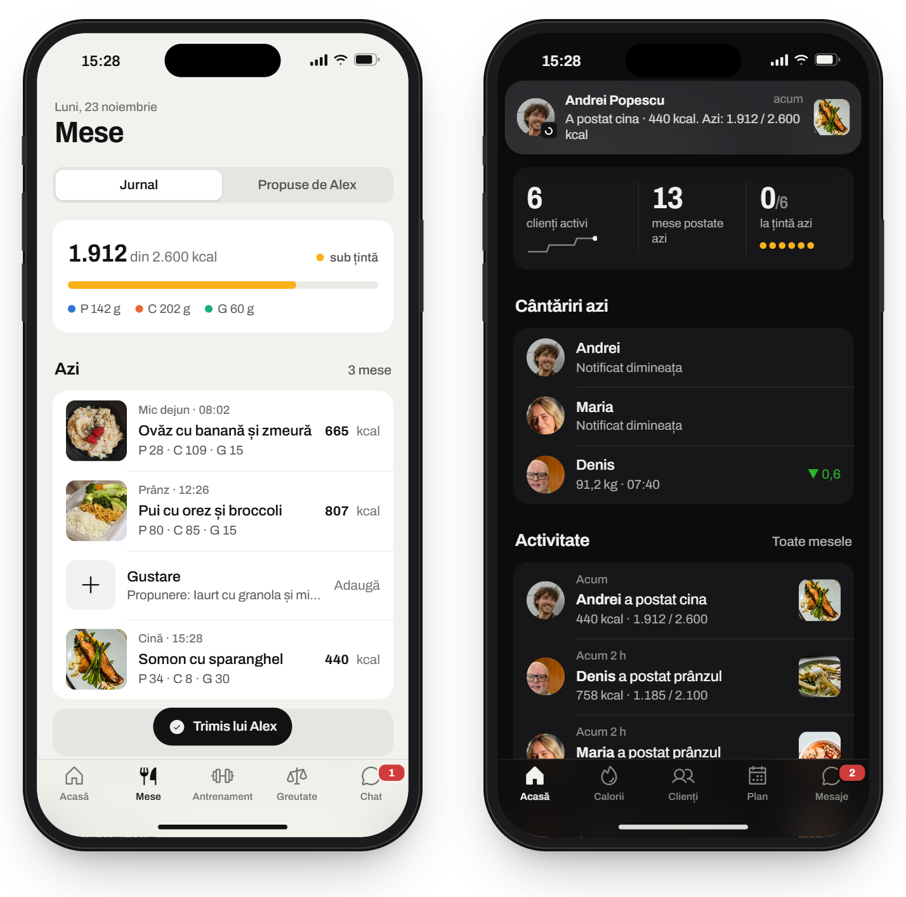
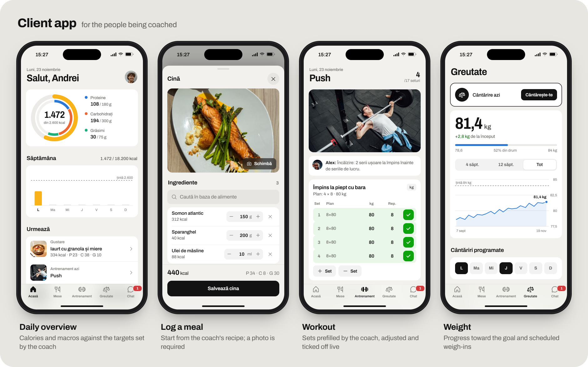
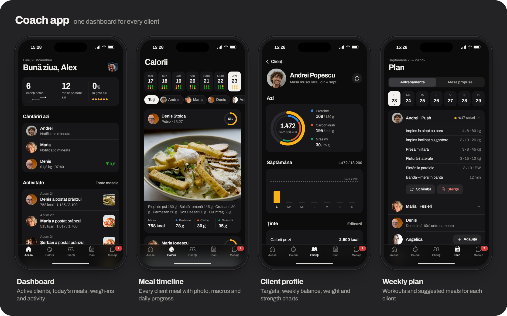

# MyFitnessCoach

**A coaching app for personal trainers and their clients.** Clients log meals (with a photo), weight and workouts from their phone. The coach sees every client in one place, in real time, and adjusts targets, workouts and meal plans from their own phone.

<p align="center">
  
</p>
<p align="center"><sub>The client logs dinner on the left. A moment later the coach gets the notification, with the photo and the client's calories for the day. The interface is in Romanian.</sub></p>

## The idea

A trainer sees a client at the gym two or three times a week. The real results depend on what happens in between: what they eat, whether they weigh in, how the workouts go. MyFitnessCoach is the tool for the time between sessions. It is private between a coach and their clients. There is no social feed and no public profile, just the data the coach needs to guide each person.

## Features

<p align="center">
  
</p>

**Client app**

- **Daily ring.** Calories in the center, with protein, carbs and fat against the targets set by the coach. The ring turns yellow below 95% of the target, green from 95% to 105% and red above 105%.
- **Weekly balance.** The week is judged as a whole (daily target × 7, ±5%). A big training day can be offset by a lighter rest day.
- **Meal logging.** Search the food database, set the grams, and the macros are calculated automatically. The coach's suggested recipe can be used as a starting point. A photo of the meal is required.
- **Workouts.** Exercises, sets, reps and weights come prefilled by the coach. The client adjusts them, ticks off each set and follows per-exercise strength charts.
- **Weight.** Progress toward the goal weight and the weigh-in days scheduled by the coach.
- **Chat** with the coach. When the coach comments on a meal, the comment appears in the chat next to the meal photo.

<p align="center">
  
</p>

**Coach app**

- **Dashboard.** Active clients, meals posted today, who is on target, today's weigh-ins and a live activity feed.
- **Meal timeline.** Every meal from every client, newest first, with photo, ingredients and the client's progress for the day. Earlier days are a tap away, and the timeline can be filtered by client.
- **Client profile.** Editable calorie and macro targets, weekly progress, weight and strength charts, the weigh-in schedule and access control.
- **Weekly plan.** Workouts assigned from reusable templates and suggested recipes, for each client and each day.

**Live sync.** Meals, weigh-ins, ticked sets, new targets and messages reach the other phone instantly over WebSockets. Everything except ticked sets also shows a notification banner, which opens the right screen when tapped.

## Tech stack

| Layer | What it uses |
|---|---|
| Backend | .NET 10 minimal API with SignalR for real-time updates |
| Front end | Plain JavaScript, HTML and CSS. No framework and no build step. Designed mobile-first for phone screens, with a light theme for clients and a dark theme for the coach |
| Charts | Calorie rings, weekly bars, weight lines and strength charts, all drawn as hand-written SVG without a chart library |
| Tests | xUnit, 19 tests covering the core rules: the ±5% daily status, the weekly target, macros calculated from grams, the required meal photo and food search |
| Assets | Fonts, icons and the SignalR client are bundled locally, so the app runs offline. Food and fitness photos are from Pexels |

## Run it locally

Requires the [.NET 10 SDK](https://dotnet.microsoft.com/download).

```bash
dotnet run --project src/MyFitnessCoach.Api
```

Open **http://localhost:5000**. Both phones appear side by side: the client (Andrei) on the left and the coach (Alex) on the right. Log a meal on the left and watch it arrive on the right.

- Client only: `/client.html` · coach only: `/trainer.html`
- The app starts with realistic demo data: six clients with a history of meals, weigh-ins and workouts. The button at the top right resets it.
- Tests: `dotnet test`

## How it is built

MyFitnessCoach is developed with an AI coding agent ([Claude Code](https://claude.com/claude-code)) as the main engineering tool. The work is driven by written documents rather than one-off prompts:

- **[Functional spec](docs/MyFitnessCoach.md)** with mockups: what the app does, written before any code and used as the source of truth for the implementation.
- **[CLAUDE.md](CLAUDE.md)**: standing instructions for the agent, covering how to run the project, where things live and the rules for the approved UI.
- **[PLAN.md](PLAN.md)**: a staged roadmap with a log of decisions. The agent updates it after every step, so each new session continues exactly where the last one stopped.
- **[Runbook](docs/RUNBOOK.md)**: known problems and their fixes, extended whenever a new issue is solved.
- **Verification**: automated tests before every commit, plus visual checks of every changed screen. The screenshots in this README were captured automatically with Playwright.

The project documents are written in Romanian.

## What's next

The roadmap in [PLAN.md](PLAN.md) takes the app to the App Store and Google Play: PostgreSQL storage, sign-in with email, Google and Apple (Firebase Authentication), coach invite codes, private photo storage in Azure, native iOS and Android builds with Capacitor, push notifications and an English interface.

## Project structure

```
src/MyFitnessCoach.Api/     .NET server (Program.cs, Data/) and the app UI (wwwroot/)
tests/MyFitnessCoach.Api.Tests/   automated tests
docs/                       functional spec, mockups, runbook, screenshots
```
